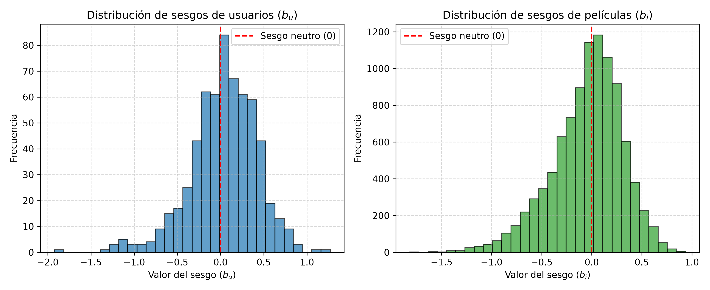
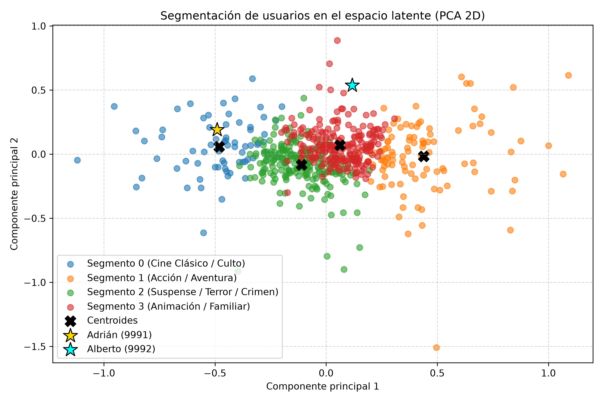

# 🎬 Sistema de Recomendación de Películas con Filtrado Colaborativo (SVD & Clustering)

> **Asignatura:** Gestión de la Información  
> **Titulación:** Grado en Ingeniería Informática — [Universidad de Burgos (UBU)](https://www.ubu.es/)  
> **Grupo de prácticas:** Grupo 12  
> **Autores:** Adrián Bello Sánchez y Alberto Cuervo Prieto  
> **Dataset:** [MovieLens 100k (`ml-latest-small`)](https://grouplens.org/datasets/movielens/)  


---

## 💻 Lenguajes y Librerías Utilizados

El desarrollo y experimentación del sistema se ha llevado a cabo íntegramente en **Python**, estructurado en un notebook interactivo (`practica_filtro_colaborativo.ipynb`) y un script ejecutable en terminal (`practica.py`), apoyándose en las siguientes librerías especializadas:

| Tecnología / Librería | Versión recomendada | Rol y Utilidad en el Proyecto |
| :--- | :--- | :--- |
| **Python** | `>= 3.10` | Lenguaje de programación principal para el pipeline de datos, algoritmos y modelado. |
| **scikit-surprise** (`surprise`) | `>= 1.1.3` | Biblioteca especializada en sistemas de recomendación. Implementa el algoritmo de factorización matricial **SVD** (*Singular Value Decomposition*), las estructuras `Reader` y `Dataset`, y el módulo de optimización `GridSearchCV`. |
| **scikit-learn** (`sklearn`) | `>= 1.3.0` | Algoritmos de Machine Learning complementarios: **K-Means** para clustering de usuarios, **PCA** (*Principal Component Analysis*) para reducción de dimensionalidad a 2D y **cosine_similarity** para distancias angulares en el espacio latente. |
| **pandas** | `>= 2.0.0` | Ingesta, limpieza y manipulación tabular de datos (`ratings.csv`, `movies.csv`), cruces relacionales, indexación y cálculo de ratios de sobrerrepresentación (*Lift*). |
| **numpy** | `>= 1.24.0` | Cálculo matricial de alto rendimiento, productos escalares entre centroides y vectores latentes ($\mathbf{c}_k \cdot \mathbf{q}_i$), y ordenaciones de índices. |
| **matplotlib** | `>= 3.7.0` | Generación, maquetación y renderizado de gráficos estadísticos de alta resolución (300 DPI). |
| **seaborn** | `>= 0.12.0` | Estilización visual avanzada, paletas temáticas y formateo de gráficos de distribución y dispersión. |
| **jupyter / ipykernel** | `>= 7.0.0` | Entorno de desarrollo interactivo reproducible paso a paso con celdas de markdown explicativas y salidas integradas. |

---

## 🎯 Objetivo del Proyecto

El objetivo principal es diseñar, entrenar y evaluar un **sistema de recomendación mediante filtrado colaborativo basado en modelos**, utilizando factorización matricial de bajo rango (**SVD**). Adicionalmente, se exploran actividades avanzadas de analítica de datos e interpretación de Machine Learning:

1. **Implementación y optimización de hiperparámetros:** Ajuste de SVD mediante validación cruzada con `GridSearchCV` sobre el dataset MovieLens 100k.
2. **Recomendación personalizada para nuevos perfiles:** Inclusión de usuarios representativos del equipo de prácticas con gustos cinematográficos contrapuestos y cálculo de sus Top-10 recomendaciones.
3. **Análisis de sesgos del modelo:** Extracción e interpretación de los sesgos de usuarios ($b_u$), sesgos de películas ($b_i$) y volumen de popularidad.
4. **Exploración del espacio latente:** Localización de relaciones semánticas entre películas en el espacio de características latentes $Q$ calculando la similitud coseno respecto a *"Toy Story"*.
5. **Segmentación de clientes mediante Clustering:** Aplicación de K-Means y PCA sobre la matriz latente de usuarios $P$ para identificar arquetipos de audiencia y patrones de consumo.

---

## 🔍 Resolución Procedural Paso a Paso

### 1. Ingesta, Exploración de Datos y Configuración de Surprise

Se utiliza el conjunto de datos **MovieLens 100k** (`ml-latest-small`), que contiene:
* **100.836 valoraciones** emitidas por **610 usuarios** sobre **9.742 películas**.
* Escala de puntuación ordinal de **0.5 a 5.0 estrellas** (con saltos de 0.5).
* Se mapea la estructura mediante `surprise.Reader(rating_scale=(0.5, 5.0))` y se instancia el objeto `surprise.Dataset`.

---

### 2. Optimización de Hiperparámetros (GridSearchCV) y Entrenamiento SVD

El algoritmo SVD modela la calificación estimada $\hat{r}_{ui}$ del usuario $u$ para la película $i$ mediante la ecuación de Simon Funk:

$$\hat{r}_{ui} = \mu + b_u + b_i + \mathbf{q}_i^T \mathbf{p}_u$$

Donde:
* $\mu$ es la media global de todas las calificaciones.
* $b_u$ es el sesgo del usuario $u$ (tendencia sistemática a puntuar más alto o bajo).
* $b_i$ es el sesgo del ítem $i$ (calidad media general percibida del film).
* $\mathbf{p}_u \in \mathbb{R}^k$ y $\mathbf{q}_i \in \mathbb{R}^k$ son los vectores de factores latentes de usuario y película respectivamente.

Para minimizar la función de coste con regularización $L_2$, se ejecutó una búsqueda en cuadrícula exhaustiva (**GridSearchCV**) evaluada mediante validación cruzada de 3 particiones (**3-Fold CV**):

* **Espacio explorado:**
  * Factores latentes (`n_factors`): `[20, 50, 100]`
  * Épocas de optimización (`n_epochs`): `[20, 30]`
  * Tasa de aprendizaje (`lr_all`): `[0.005, 0.01]`
  * Coeficiente de regularización (`reg_all`): `[0.05, 0.1]`

#### Resultados de la Optimización:
* **Mejores hiperparámetros encontrados:** `n_factors = 50`, `n_epochs = 30`, `lr_all = 0.01`, `reg_all = 0.1`.
* **RMSE obtenido:** **0.8642** (mejora frente al modelo base de 0.8717).
* **MAE obtenido:** **0.6623** (mejora frente al modelo base de 0.6701).

> [!NOTE]
> Un MAE de **0.66** indica que el modelo comete un error medio de poco más de media estrella en una escala de 1 a 5, ofreciendo una precisión excelente para un catálogo con más del 98% de dispersión (*sparsity*).

---

### 3. Incorporación de Perfiles del Equipo y Top 10 Recomendaciones

Se definieron e inyectaron al catálogo dos perfiles de usuario calibrados con preferencias nítidas:
* **Adrián (`userId: 9991`):** Entusiasta de la Ciencia Ficción, Thriller y Acción de culto (*Matrix*, *Inception*, *Interstellar*, *Star Wars* con 5.0★; comedias románticas ligeras como *Pretty Woman* con 1.0★).
* **Alberto (`userId: 9992`):** Aficionado a la Animación, Fantasía y Cine Familiar (*Toy Story 1, 2 y 3*, *El Rey León*, *Aladdín*, *Buscando a Nemo* con 5.0★; cine violento o de terror como *Terminator 2* o *El Resplandor* con 1.0★–1.5★).

Tras reajustar el modelo sobre el catálogo ampliado y aplicar un filtro de soporte estadístico (películas no vistas con al menos 20 valoraciones en la comunidad para evitar anomalías), las 10 mejores recomendaciones generadas fueron:

#### Top 10 Recomendaciones para Adrián (`userId 9991` — Sci-Fi / Acción)
| # | Título de la Película | Géneros | Predicción ($\hat{r}_{ui}$) |
| :-: | :--- | :--- | :-: |
| **1** | *Lawrence of Arabia (1962)* | Adventure \| Drama \| War | **4.49** |
| **2** | *The Shawshank Redemption (1994)* | Crime \| Drama | **4.44** |
| **3** | *The Godfather (1972)* | Crime \| Drama | **4.41** |
| **4** | *Fight Club (1999)* | Action \| Crime \| Drama \| Thriller | **4.39** |
| **5** | *Platoon (1986)* | Drama \| War | **4.37** |
| **6** | *The Silence of the Lambs (1991)* | Crime \| Horror \| Thriller | **4.37** |
| **7** | *The Godfather: Part II (1974)* | Crime \| Drama | **4.35** |
| **8** | *Snatch (2000)* | Comedy \| Crime \| Thriller | **4.33** |
| **9** | *Wallace & Gromit: The Best of Aardman (1996)* | Adventure \| Animation \| Comedy | **4.32** |
| **10** | *The Lord of the Rings: The Fellowship of the Ring (2001)* | Adventure \| Fantasy | **4.31** |

#### Top 10 Recomendaciones para Alberto (`userId 9992` — Animación / Familiar)
| # | Título de la Película | Géneros | Predicción ($\hat{r}_{ui}$) |
| :-: | :--- | :--- | :-: |
| **1** | *Sunset Blvd. (1950)* | Drama \| Film-Noir \| Romance | **4.27** |
| **2** | *The Big Short (2015)* | Drama | **4.23** |
| **3** | *Notorious (1946)* | Film-Noir \| Romance \| Thriller | **4.22** |
| **4** | *For a Few Dollars More (1965)* | Action \| Drama \| Thriller \| Western | **4.19** |
| **5** | *The Shawshank Redemption (1994)* | Crime \| Drama | **4.18** |
| **6** | *Life Is Beautiful (La Vita è bella) (1997)* | Comedy \| Drama \| Romance \| War | **4.18** |
| **7** | *Das Boot (The Boat) (1981)* | Action \| Drama \| War | **4.17** |
| **8** | *A Streetcar Named Desire (1951)* | Drama | **4.17** |
| **9** | *Goodfellas (1990)* | Crime \| Drama | **4.17** |
| **10** | *Casablanca (1942)* | Drama \| Romance | **4.17** |

---

### 4. Análisis de Sesgos Estimados ($b_u$ y $b_i$)

La media global del dataset es $\mu = \mathbf{3.50}$ estrellas. El análisis de los términos de sesgo permite entender las desviaciones estructurales:

* **Usuarios extremos:**
  * **Más benevolentes ($b_u \gg 0$):** `userId 53` ($b_u = +1.28$, media real $5.00\star$), `userId 43` ($b_u = +1.16$, media real $4.55\star$).
  * **Más críticos ($b_u \ll 0$):** `userId 442` ($b_u = -1.99$, media real $1.28\star$), `userId 153` ($b_u = -1.43$, media real $2.22\star$).
* **Películas más votadas y aclamadas ($b_i > 0$):** *Forrest Gump* (329 votos, $b_i = +0.66$), *The Shawshank Redemption* (317 votos, $b_i = +0.91$), *Pulp Fiction* (308 votos, $b_i = +0.70$), *The Matrix* (280 votos, $b_i = +0.68$).

#### Explicación Visual de la Distribución de Sesgos

A continuación se muestra el histograma comparativo generado por el pipeline:



> **Interpretación del Gráfico de Sesgos:**
> * **Panel izquierdo (Sesgos de Usuarios $b_u$):** Sigue una distribución aproximadamente normal centrada en torno a $0.0$. La línea discontinua roja marca la neutralidad respecto a la media global ($3.50$). Se observa una cola izquierda más pronunciada que alcanza valores de hasta $-2.0$, evidenciando la presencia de usuarios hipercríticos cuya escala personal difiere drásticamente del usuario promedio.
> * **Panel derecho (Sesgos de Películas $b_i$):** Presenta una forma acampanada con una marcada asimetría hacia valores positivos altos ($> +0.8$). Esto ilustra que las películas con mayor consenso crítico positivo logran un fuerte despegue por encima de la media global, mientras que el grueso de títulos de catálogo se estabiliza en torno a valores neutros o moderadamente negativos.

---

### 5. Análisis en el Espacio Latente (Similitud Coseno con *Toy Story*)

Cada película $i$ queda descrita por un vector latente $\mathbf{q}_i \in \mathbb{R}^{50}$ que condensa sus características abstractas aprendidas automáticamente por el modelo.

Para descubrir los títulos más afines a ***Toy Story (1995)*** ($movieId = 1$), calculamos la **similitud coseno** vectorial respecto a todas las películas con al menos 20 valoraciones:

$$\text{sim}(\mathbf{q}_{\text{ToyStory}}, \mathbf{q}_i) = \frac{\mathbf{q}_{\text{ToyStory}} \cdot \mathbf{q}_i}{\|\mathbf{q}_{\text{ToyStory}}\| \, \|\mathbf{q}_i\|}$$

#### Top 10 Películas más Próximas a *Toy Story* en el Espacio Latente:
| # | Título | Géneros | Similitud Coseno | Calificaciones |
| :-: | :--- | :--- | :-: | :-: |
| **1** | *Toy Story 2 (1999)* | Adventure \| Animation \| Children \| Comedy \| Fantasy | **0.959** | 97 |
| **2** | *Toy Story 3 (2010)* | Adventure \| Animation \| Children \| Comedy \| Fantasy \| IMAX | **0.893** | 55 |
| **3** | *Wallace & Gromit: The Wrong Trousers (1993)* | Animation \| Comedy \| Short \| Thriller | **0.865** | 56 |
| **4** | *Bug's Life, A (1998)* | Adventure \| Animation \| Children \| Comedy | **0.854** | 92 |
| **5** | *Monsters, Inc. (2001)* | Adventure \| Animation \| Children \| Comedy \| Fantasy | **0.852** | 132 |
| **6** | *Incredibles, The (2004)* | Action \| Adventure \| Animation \| Children \| Comedy | **0.849** | 125 |
| **7** | *Finding Nemo (2003)* | Adventure \| Animation \| Children \| Comedy | **0.846** | 141 |
| **8** | *Aladdin (1992)* | Adventure \| Animation \| Children \| Comedy \| Musical | **0.843** | 183 |
| **9** | *Lion King, The (1994)* | Adventure \| Animation \| Children \| Drama \| Musical \| IMAX | **0.838** | 172 |
| **10** | *Shrek (2001)* | Adventure \| Animation \| Children \| Comedy \| Fantasy \| Romance | **0.835** | 170 |

> [!TIP]
> **Hallazgo semántico:** Sin haber suministrado al modelo los textos de las sinopsis ni las etiquetas de género durante el entrenamiento de SVD, el algoritmo agrupa de forma natural las secuelas directas de la saga (*Toy Story 2* y *3*) en los puestos 1 y 2, seguidas de los grandes hitos de animación digital de Pixar/DreamWorks/Disney (*Monsters, Inc.*, *Buscando a Nemo*, *Aladdín*). Esto confirma que las dimensiones latentes capturan la esencia estilística y tonal del contenido.

---

### 6. Clustering de Usuarios y Segmentación de Audiencia (K-Means + PCA)

Se aplicó **K-Means ($k=4$)** directamente sobre los vectores latentes de usuarios $\mathbf{p}_u \in \mathbb{R}^{50}$.

Para caracterizar rigurosamente cada segmento y evitar el sesgo de popularidad general del catálogo:
* **Películas insignia:** Se calcularon evaluando la afinidad latente entre el centroide del cluster $\mathbf{c}_k$ y los vectores de las películas con suficiente soporte ($\mathbf{c}_k \cdot \mathbf{q}_i$).
* **Géneros distintivos:** Se identificaron mediante el ratio de sobrerrepresentación relativa (**Lift**) en calificaciones altas ($\ge 4.0\star$) respecto a la distribución global de MovieLens:

$$\text{Lift}(g, c) = \frac{P(g \mid \text{Cluster } c, r \ge 4.0)}{P(g \mid \text{Global}, r \ge 4.0)}$$

#### Perfil de los 4 Segmentos Identificados:
* **Segmento 0 (75 usuarios, 12.3%) — *Cine Familiar, Aventura y Animación*:**
  * **Géneros clave:** *Children, IMAX, Adventure*.
  * **Películas insignia:** *Home Alone 2: Lost in New York*, *Twister*, *The Chronicles of Narnia*.
  * 👉 **Alberto (`userId 9992`)** queda clasificado aquí, concordando con sus preferencias de cine animado.
* **Segmento 1 (116 usuarios, 19.0%) — *Blockbusters de Acción y Sagas Espaciales*:**
  * **Géneros clave:** *Western, War, Action*.
  * **Películas insignia:** *Top Gun*, *Star Wars: Episode I*, *Star Trek IV: The Voyage Home*.
* **Segmento 2 (96 usuarios, 15.7%) — *Cine de Culto, Crimen y Cine Negro*:**
  * **Géneros clave:** *Film-Noir, Mystery, Drama*.
  * **Películas insignia:** *The Big Lebowski*, *Pulp Fiction*, *A Clockwork Orange*.
* **Segmento 3 (325 usuarios, 53.1%) — *Suspense Psicológico, Terror y Cine Alternativo*:**
  * **Géneros clave:** *Documentary, IMAX, Horror, Mystery*.
  * **Películas insignia:** *The Blair Witch Project*, *Brazil*, *Night of the Living Dead*.
  * 👉 **Adrián (`userId 9991`)** queda clasificado en este segmento, reflejando su perfil de ciencia ficción oscura y thrillers.

#### Explicación Visual del Clustering en el Espacio Latente (PCA 2D)



> **Interpretación del Gráfico de Clustering:**
> * **Reducción de Dimensionalidad (PCA 2D):** Los 50 factores latentes de cada usuario se proyectan linealmente a 2 componentes principales para hacer comprensible la nube de puntos multidimensional.
> * **Grupos de Audiencia:** Cada color diferencia a uno de los 4 conglomerados de usuarios detectados por K-Means, observándose una separación natural de preferencias.
> * **Centroides ($\mathbf{X}$ negra):** Marcan el epicentro latente de cada comunidad de usuarios.
> * **Usuarios del Equipo ($\bigstar$ destacadas):**
>   * La estrella **dorada** representa a **Adrián (`userId 9991`)**, perfectamente integrada en la región del **Segmento 3** (cine conceptual y de suspense).
>   * La estrella **cian** representa a **Alberto (`userId 9992`)**, posicionada en el cuadrante del **Segmento 0** (cine familiar y de animación).
>
> Esta visualización certifica la validez práctica del filtrado colaborativo para segmentar clientes en plataformas comerciales (ej. Netflix o Disney+), habilitando interfaces de usuario personalizadas y campañas de marketing dirigidas.

---

## 📂 Estructura del Repositorio

```text
Machine-learning-film-recommendation-model/
│
├── README.md                           # Documentación principal del proyecto (GitHub)
├── requirements.txt                    # Lista de dependencias del entorno Python
├── LICENSE                             # Licencia de código abierto MIT
├── README.txt                          # Ficha técnica oficial del dataset MovieLens
│
├── practica.py                         # Script Python completo ejecutable por terminal
├── practica_filtro_colaborativo.ipynb  # Jupyter Notebook interactivo con celdas y visualizaciones
│
├── sesgos_distribucion.png             # Gráfica de distribución de sesgos (bu y bi)
├── clusters_usuarios.png               # Gráfica de segmentación K-Means proyectada con PCA
│
├── docs/                               # Documentación y manuales adicionales
│   ├── MANUAL_USO_RAPIDO.md            # Guía detallada de instalación y comandos
│   └── requirements.txt                # Réplica de dependencias para el directorio docs
│
└── dataset/                            # Archivos del dataset MovieLens 100k
    ├── ml-latest-small.zip             # Archivo comprimido con el dataset original
    └── readme.md                       # Especificaciones de MovieLens
```

---

## ⚙️ Instalación y Guía de Uso

### 1. Clonar el repositorio y preparar el entorno

```bash
# Clonar el repositorio
git clone https://github.com/cl4sic/Machine-learning-film-recommendation-model.git
cd Machine-learning-film-recommendation-model

# Crear y activar entorno virtual (Linux/macOS)
python3 -m venv venv
source venv/bin/activate

# En Windows:
# python -m venv venv
# venv\Scripts\activate

# Instalar dependencias
pip install -r requirements.txt
```

### 2. Ejecutar mediante Script de Terminal

Para ejecutar todo el pipeline de principio a fin, entrenar el modelo, mostrar las tablas por consola y regenerar las figuras `.png`:

```bash
python practica.py
```

### 3. Ejecutar mediante Jupyter Notebook

Para explorar los pasos de forma interactiva con salidas detalladas:

```bash
jupyter notebook practica_filtro_colaborativo.ipynb
```

---

## 📊 Resumen de Resultados Clave

| Métrica / Parámetro | Valor Obtenido | Significado Práctico |
| :--- | :---: | :--- |
| **Mejor RMSE** | **0.8642** | Error cuadrático medio de predicción minimizado mediante SVD regularizado. |
| **Mejor MAE** | **0.6623** | Error absoluto medio de ~0.66 estrellas en escala de 0.5 a 5.0. |
| **Factores Latentes ($k$)** | **50** | Dimensión del espacio vectorial que captura conceptos abstractos de películas y gustos. |
| **Media Global ($\mu$)** | **3.50★** | Calificación neutra del catálogo antes de ponderar sesgos de usuario y película. |
| **Similitud Toy Story 1-2** | **0.959** | Máxima correlación semántica encontrada en el espacio latente sin datos textuales. |
| **Segmentos K-Means** | **4 clusters** | Diferenciación nítida de arquetipos de audiencia con asignación coherente de los autores. |

---

## 📜 Licencia y Referencias

* **Dataset:** F. Maxwell Harper and Joseph A. Konstan. 2015. *The MovieLens Datasets: History and Context*. ACM Transactions on Interactive Intelligent Systems (TiiS) 5, 4: 19:1–19:19. https://doi.org/10.1145/2827872
* **Biblioteca Surprise:** Nicolas Hug. 2020. *Surprise: A Python library for recommender systems*. Journal of Open Source Software, 5(52), 2174. https://surprise.readthedocs.io/
* **Licencia:** Distribuido bajo la licencia [MIT](LICENSE).
